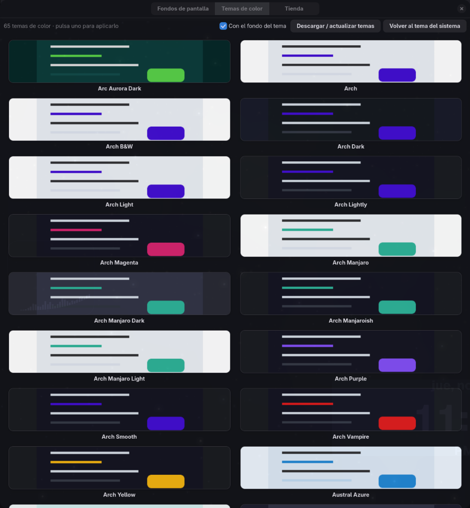

# HyprBazar

**Estantería de temas para Hyprland**: elige fondos de pantalla, aplica paletas de
color completas y descarga temas de la comunidad, todo desde una ventana, en
español y sin tocar tu configuración.

<p align="center">
  
  
</p>

---

## Qué hace

| Pestaña | Para qué |
|---|---|
| **Fondos de pantalla** | todos tus fondos con su miniatura; un clic lo pone en todos los monitores y DMS recolorea el escritorio a partir de él |
| **Temas de color** | paletas completas (Catppuccin, Dracula, Nord, Tokyo Night, Kanagawa, Arch…) con **vista previa generada**; aplica bordes, esquinas, huecos, desenfoque, barra de título y colores de kitty |
| **Tienda** | busca temas en GitHub, muestra la **captura real** de cada repo, **traduce la descripción al español** y descarga solo lo aprovechable (paletas y fondos) |

Y dos cosas que casi nadie hace bien:

- **Deshacer de verdad**: antes de aplicar se guardan tus valores (bordes,
  esquinas, huecos, desenfoque, colores de la barra) y *Volver al tema del
  sistema* los deja exactamente como estaban.
- **Nada de copiar dotfiles ajenos**: nunca se sobrescriben tus binds, tu barra
  ni tu configuración. Solo se añaden temas que tú aplicas cuando quieres.

## Instalación

```bash
git clone https://github.com/pilahito/hyprbazar.git
cd hyprbazar
./install.sh
```

Deja los ejecutables en `~/.local/bin`, crea la entrada de menú y comprueba las
dependencias.

**Dependencias**: `python3` con PyGObject (GTK 4), `imagemagick`, `jq`, `curl`,
`git` y `wl-clipboard`.

```bash
sudo pacman -S python-gobject gtk4 imagemagick jq curl git wl-clipboard
```

## Uso

```bash
hyprbazar                 # abre la ventana
hyprbazar-paleta listar   # temas de color disponibles
hyprbazar-paleta aplicar dracula --fondo
hyprbazar-paleta restaurar
hyprbazar-tienda buscar "hyprland themes"
hyprbazar-tienda instalar victorsosaMx/hyperland
```

Atajo sugerido, en tu `binds-user.lua`:

```lua
hl.bind("SUPER + SHIFT + Y", hl.dsp.exec_cmd("hyprbazar"),
        { description = "HyprBazar (temas)" })
```

## Dónde guarda las cosas

| Ruta | Contenido |
|---|---|
| `~/.local/share/temas-paletas/` | paletas descargadas |
| `~/.local/share/tienda/` | repos de la tienda ya bajados |
| `~/.cache/temas-hyprland/` | miniaturas y caché de traducciones |
| `~/.cache/tienda/` | portadas y avatares |
| `~/.config/hypr/temas/` | tu lista de fondos (`temas.txt`) y `cambiar-tema.sh` |

## Cómo aplica un tema

1. **Paleta**: lee `colors.json` + `theme.json` del tema y ajusta Hyprland
   (`general`, `decoration`, `plugin:hyprbars`) y `~/.config/kitty/tema-actual.conf`.
2. **Fondo**: si el tema trae `default_wallpaper`, lo descarga y lo pone con DMS
   y `awww`; DMS regenera su paleta Material desde la imagen, así que la barra y
   los menús también cambian.
3. **Deshacer**: los valores previos se guardan en `~/.cache/temas-paletas/antes.jsonl`
   y se reaplican al pulsar *Volver al tema del sistema* (sin `hyprctl reload`,
   que en Hyprland 0.57 dejaría las ventanas sin barra de título).

## Requisitos del sistema

Probado en Arch Linux con Hyprland 0.57.2, GTK 4.24 y DMS (Dux Modular Shell).
La pestaña de fondos funciona con cualquier gestor de fondos; el recoloreado
automático depende de DMS/matugen.

## English

**HyprBazar** is a theme shelf for Hyprland: pick wallpapers, apply full color
palettes and browse a community store — all in one window. The store searches
GitHub, shows real screenshots, translates descriptions to Spanish and downloads
only palettes and wallpapers: it never overwrites your dotfiles.

```bash
git clone https://github.com/pilahito/hyprbazar.git && cd hyprbazar && ./install.sh
```

Requires Python 3 + PyGObject (GTK 4), ImageMagick, jq, curl and git.

## Licencia

MIT — ver [LICENSE](LICENSE).

Hecho por [David Pilahito](https://github.com/pilahito) para uso diario en su
propio escritorio.
