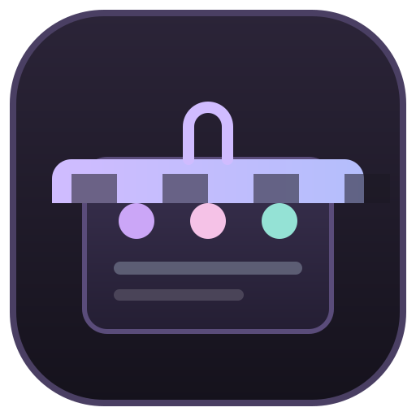
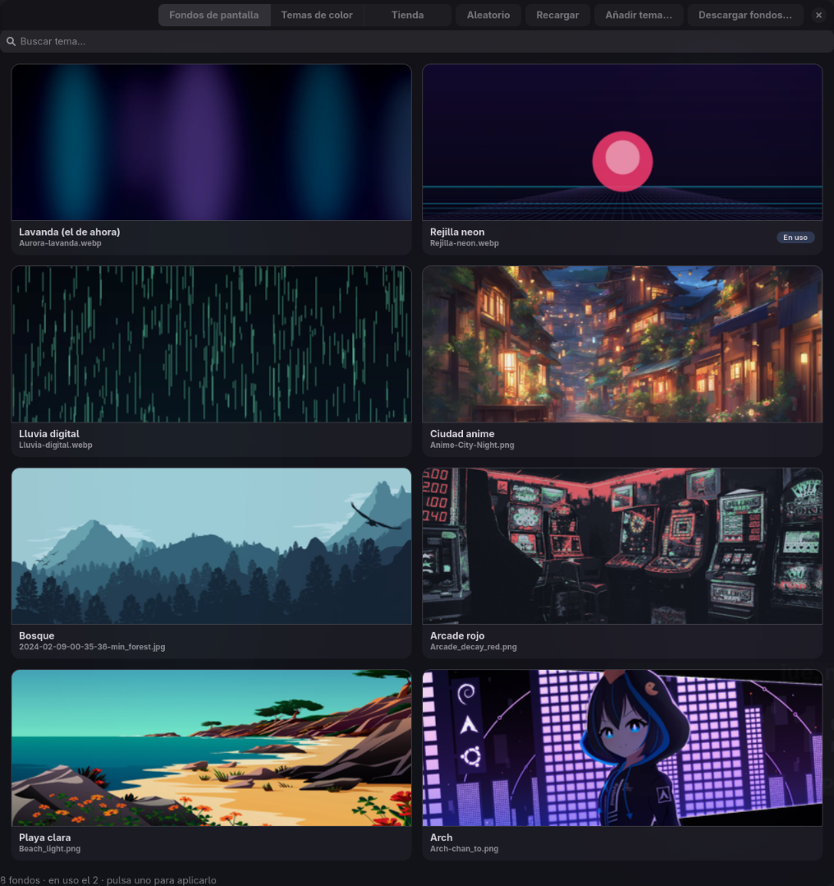
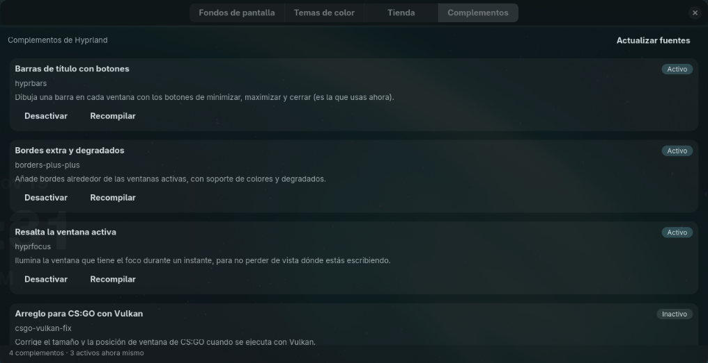

# HyprBazar

**Estantería de temas para Hyprland**: elige fondos de pantalla, aplica paletas de
color completas y descarga temas de la comunidad, todo desde una ventana, en
español y sin tocar tu configuración.

<p align="center">
  
  
  
</p>

---

## Qué hace

| Pestaña | Para qué |
|---|---|
| **Fondos de pantalla** | todos tus fondos con su miniatura; un clic lo pone en todos los monitores y DMS recolorea el escritorio a partir de él |
| **Temas de color** | paletas completas (Catppuccin, Dracula, Nord, Tokyo Night, Kanagawa, Arch…) con **vista previa generada**; aplica bordes, esquinas, huecos, desenfoque, barra de título y colores de kitty |
| **Complementos** | estado de los plugins de Hyprland (hyprbars, borders-plus-plus, hyprfocus, csgo-vulkan-fix): activarlos, desactivarlos, recompilarlos y actualizar sus fuentes |
| **Tienda** | busca temas en GitHub, muestra la **captura real** de cada repo, **traduce la descripción al español** y descarga lo aprovechable (paletas, fondos y temas GTK, de iconos, cursores y Kvantum) e **instala solo sus dependencias** desde los repos oficiales de Arch |
| **Temas del sistema** | combina aplicaciones GTK, iconos, cursor y Qt aunque vengan de un tema GNOME o KDE; en «Tema completo» eliges qué partes aplicar y qué partes conservar, puedes guardar la combinación y deshacerla; vista previa del cursor |
| **Sonido** | mezclador de volumen, sonidos del teclado y posición y visibilidad del indicador de volumen DMS |
| **Editar colores** | en cada tema de color, **Editar colores** abre un editor y lo guarda como **tema propio** |
| **Escritorio completo** | en los rices de otros escritorios (BSPWM, i3…), instala ese escritorio **aparte** con sus paquetes (oficiales y AUR) y su configuración, sin tocar tu Hyprland; eliges cuál usar al iniciar sesión |

Y dos cosas que casi nadie hace bien:

- **Deshacer de verdad**: antes de aplicar se guardan tus valores (bordes,
  esquinas, huecos, desenfoque, colores de la barra) y *Volver al tema del
  sistema* los deja exactamente como estaban.
- **Nada de copiar dotfiles ajenos**: nunca se sobrescriben tus binds, tu barra
  ni tu configuración. Solo se añaden temas que tú aplicas cuando quieres.

En **Temas del sistema**, selecciona «Personalizado (temas instalados)» para
combinar temas GTK, iconos, cursor y Kvantum de cualquier origen. Cada selector
tiene «Conservar actual» para dejar intacta esa parte. «Aplicar todo» respeta
los cambios que acabas de elegir; «Guardar como tema completo» los recuerda.
Las casillas de colores y fondo permiten incluirlos solo si el tema los trae.
«Deshacer» restaura únicamente las partes que cambiaste.

La galería **Animados** incluye otra colección de GIF y permite buscar en
español (por ejemplo «juegos», «futurista» o «espacio»); traduce esos términos
al buscar en los catálogos públicos. Los archivos se descargan únicamente
cuando los eliges.
**Más fuentes** abre 4K Wallpapers, MotionBGs, MyLiveWallpapers, DesktopHut,
WallsFlow, Pixabay, Pexels, Videezy, Wallhaven y Unsplash en el navegador.
Descarga el fondo que quieras y pulsa **Importar archivo**: imágenes y GIF se
añaden a Mis fondos; si eliges un vídeo MP4/WebM/MOV/MKV, se convierte una
muestra de hasta 12 segundos en GIF para reproducirla con el fondo animado de
este escritorio. El vídeo original no se modifica. La búsqueda directa de
Pixabay y Pexels requiere una clave API de cada servicio.

En **Temas del sistema**, el cursor seleccionado muestra su dibujo real antes
de aplicarse. «Más cursores · GNOME Look» abre el catálogo comunitario en la
**Tienda**: cada tarjeta muestra el nombre y la foto completa, y «Ver dibujos»
enseña las demás capturas antes de instalar. KDE Store comparte ese catálogo.

En **Sonido**, «Indicador de volumen en pantalla» permite elegir dónde aparece,
activar los avisos y mostrar el porcentaje. Al pulsar «Aplicar indicador» solo
se modifican esas opciones de DMS y se conserva una copia de la configuración.

## Instalación

Una sola línea (en Arch pide tu contraseña solo para instalar dependencias):

```bash
git clone https://github.com/pilahito/hyprbazar.git && cd hyprbazar && ./install.sh
```

Deja los ejecutables en `~/.local/bin`, crea la entrada de menú, el icono y
**instala solo las dependencias que falten**. Si algo no se puede instalar, te
dice exactamente qué comando ejecutar. Para actualizar, vuelve a ejecutar
`./install.sh`; para quitarlo, `./install.sh --desinstalar` (no toca tus temas
ni tu configuración).

**Dependencias**: `python3` con PyGObject (GTK 4), `imagemagick`, `jq`, `curl`,
`git` y `wl-clipboard`.

```bash
sudo pacman -S python-gobject gtk4 imagemagick jq curl git wl-clipboard
```

**Novedades**: la Tienda pagina el contenido de OpenDesktop, hay una pestaña
**Vista previa** (solo lectura) para ver cómo quedará el tema, y el instalador
de **Escritorio completo** funciona en cola: una instalación a la vez y, si
`pacman` falla, lo dice en lugar de dar el trabajo por hecho.

## Uso

```bash
hyprbazar                 # abre la ventana
hyprbazar-paleta listar   # temas de color disponibles
hyprbazar-paleta aplicar dracula --fondo
hyprbazar-paleta restaurar
hyprbazar-tienda buscar "hyprland themes"
hyprbazar-tienda instalar victorsosaMx/hyperland
```

Atajo sugerido, en tu `binds-user.lua`:

```lua
hl.bind("SUPER + SHIFT + Y", hl.dsp.exec_cmd("hyprbazar"),
        { description = "HyprBazar (temas)" })
```

## Aplicar el aspecto de un repo de la tienda

Los repos con dotfiles de Hyprland que instales desde la **Tienda** tienen un
botón **«Aplicar tema»**: coge **solo la parte visual** (huecos, borde, esquinas,
opacidades, desenfoque y logo) y la aplica a tu escritorio.

- **No copia** binds, `exec-once`, plugins ni ficheros completos: nada que pueda
  romper tu configuración.
- Antes de tocar nada guarda una foto de cómo estabas, y el botón
  **«Volver a como estaba»** restaura tu aspecto anterior.
- Lo aplicado vive en `~/.config/hypr/tema-repo.lua`, aparte de tu config.

Recarga con el botón **Recargar** o con **F5**: relee los repos descargados (para
que aparezcan al momento los que acabas de instalar), la carpeta de fondos y las
paletas, sin cerrar la aplicación.

Desde terminal:

```bash
hyprbazar-tema listar            # repos ya descargados
hyprbazar-tema ver owner-repo    # qué cambiaría, sin tocar nada
hyprbazar-tema aplicar owner-repo
hyprbazar-tema restaurar
```

## Sonido: galería de teclas

En la pestaña **Sonido** cada pack aparece como una **imagen de su tecla**
(cuerpo, color del interruptor y material: ABS/PBT) con su botón **Aplicar**,
en vez de una lista desplegable. La imagen se genera la primera vez con
ImageMagick y queda en `~/.local/share/hyprbazar/teclas/`.

Si pulsas **«Descargar fotos reales»**, la app baja fotos de los interruptores
(Cherry MX azul, rojo, marrón, negro…) de **Wikimedia Commons**, casi todas de
dominio público o CC0, y las usa en lugar de las teclas dibujadas. Los autores y
licencias quedan en `hyprbazar-teclas creditos`.

Además la pestaña trae un **teclado en pantalla** que se ilumina con las teclas
que pulsas, para comprobar que se lee el teclado correcto.

## Integración con Hyprland

En [`hypr/`](hypr/) están los scripts de los **botones de ventana** (minimizar
real a un escritorio oculto, maximizar, cerrar solo esa ventana) y dos
utilidades: `arreglar-barras.sh` (recarga hyprbars cuando desaparecen las
barras tras un `hyprctl reload`) y `revisar-config.sh` (comprueba errores de
configuración). Ver [hypr/README.md](hypr/README.md).

## Dónde guarda las cosas

| Ruta | Contenido |
|---|---|
| `~/.local/share/temas-paletas/` | paletas descargadas |
| `~/.local/share/tienda/` | repos de la tienda ya bajados |
| `~/.cache/temas-hyprland/` | miniaturas y caché de traducciones |
| `~/.cache/tienda/` | portadas y avatares |
| `~/.config/hypr/temas/` | tu lista de fondos (`temas.txt`) y `cambiar-tema.sh` |

## Cómo aplica un tema

1. **Paleta**: lee `colors.json` + `theme.json` del tema y ajusta Hyprland
   (`general`, `decoration`, `plugin:hyprbars`) y `~/.config/kitty/tema-actual.conf`.
2. **Fondo**: si el tema trae `default_wallpaper`, lo descarga y lo pone con DMS
   y `awww`; DMS regenera su paleta Material desde la imagen, así que la barra y
   los menús también cambian.
3. **Deshacer**: los valores previos se guardan en `~/.cache/temas-paletas/antes.jsonl`
   y se reaplican al pulsar *Volver al tema del sistema* (sin `hyprctl reload`,
   que en Hyprland 0.57 dejaría las ventanas sin barra de título).

## Requisitos del sistema

Probado en Arch Linux con Hyprland 0.57.2, GTK 4.24 y DMS (Dux Modular Shell).
La pestaña de fondos funciona con cualquier gestor de fondos; el recoloreado
automático depende de DMS/matugen.

## English

**HyprBazar** is a theme shelf for Hyprland: pick wallpapers, apply full color
palettes and browse a community store — all in one window. The store searches
GitHub, shows real screenshots, translates descriptions to Spanish and downloads
only palettes and wallpapers: it never overwrites your dotfiles.

```bash
git clone https://github.com/pilahito/hyprbazar.git && cd hyprbazar && ./install.sh
```

Requires Python 3 + PyGObject (GTK 4), ImageMagick, jq, curl and git.

## Licencia

MIT — ver [LICENSE](LICENSE).

Hecho por [David Pilahito](https://github.com/pilahito) para uso diario en su
propio escritorio.
